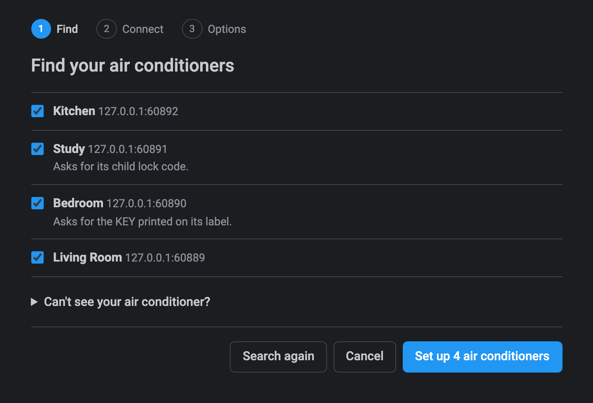
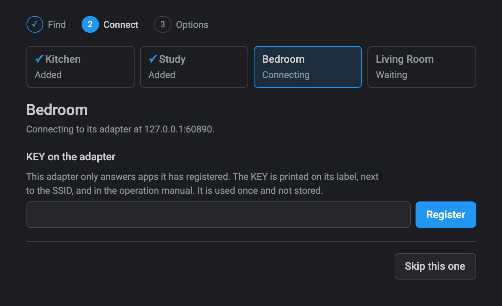
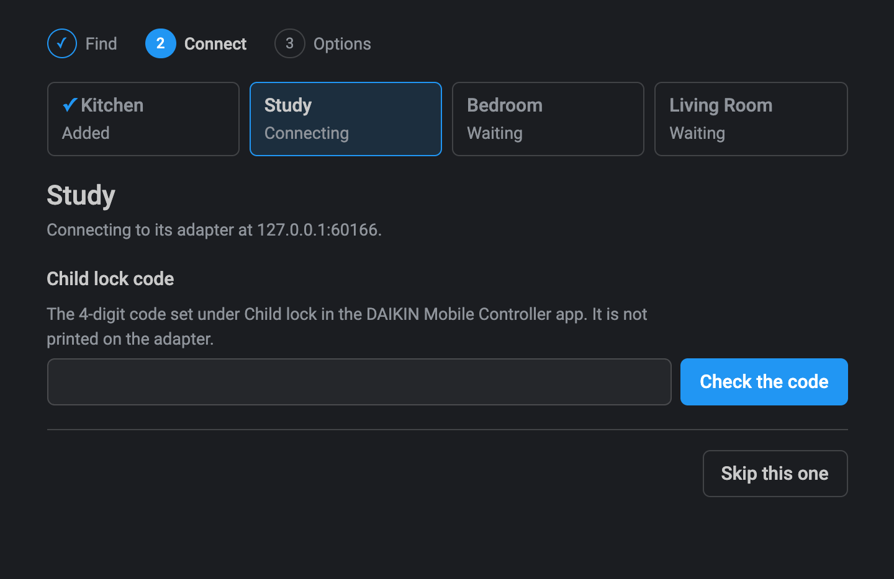
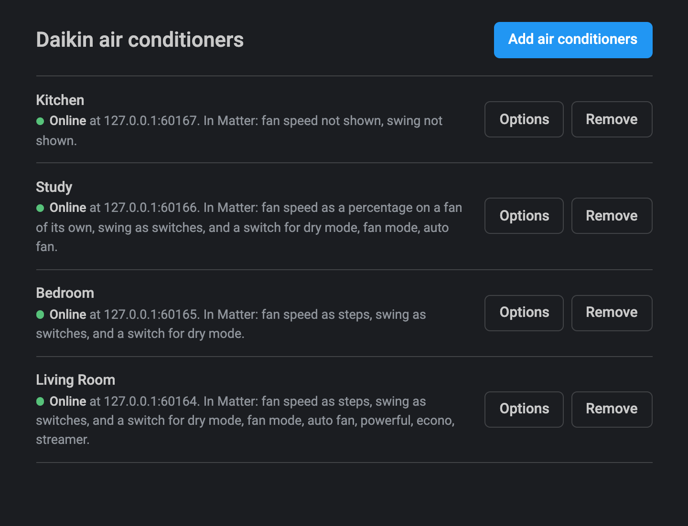
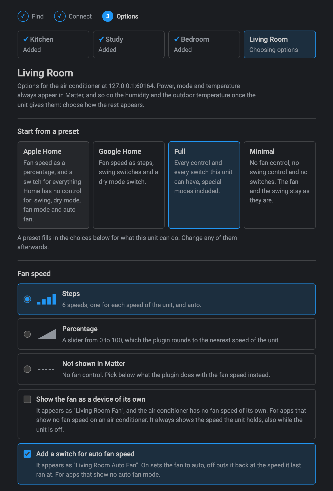
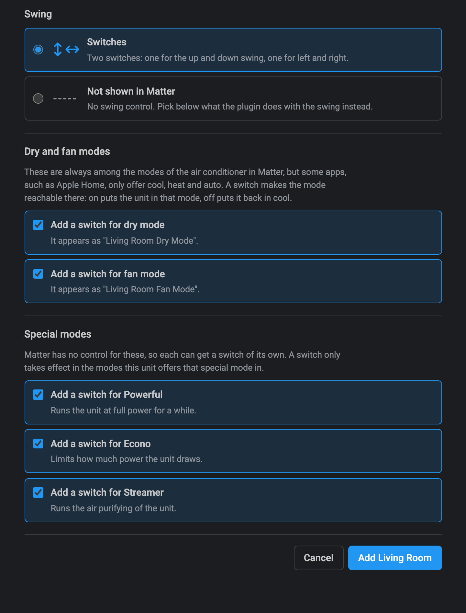

# Matterbridge Daikin Local

[](https://www.npmjs.com/package/matterbridge-daikin-local)
[](https://www.npmjs.com/package/matterbridge-daikin-local)
[](https://github.com/cheziyi/matterbridge-daikin-local/actions/workflows/build.yml)
[](https://github.com/cheziyi/matterbridge-daikin-local/actions/workflows/codeql.yml)
[](https://codecov.io/gh/cheziyi/matterbridge-daikin-local)
[](./LICENSE)

[](https://www.npmjs.com/package/matterbridge)
[](https://www.npmjs.com/package/daikin-local-control)

Control your Daikin air conditioners from Apple Home, Google Home, Alexa, Home Assistant and other Matter apps, **entirely over your local network**. No cloud, no Daikin account, and nothing that stops working when your internet does.

It is a [Matterbridge](https://matterbridge.io) plugin built on [daikin-local-control](https://www.npmjs.com/package/daikin-local-control), for units with a classic (BRP069, BRP072), DSIOT (BRP084) or Airbase (BRP15B61) Wi-Fi adapter: the adapters of the DAIKIN Mobile Controller, Daikin Airbase and ONECTA apps. Not every adapter of each app is covered: see its [coverage and limitations](https://github.com/cheziyi/daikin-local-control#coverage--limitations).

## Why this plugin

- **It finds your air conditioners for you.** Open the setup page and it searches your network, lists every adapter that answers and says what each one will ask for. There are no IP addresses to look up and no configuration file to edit: see [Guided setup](#guided-setup).
- **It works with adapters that ask for their KEY.** Some classic adapters only answer an app they have registered, and some have a child lock code. The setup page asks for each where it is needed, and the plugin does the rest. It is the only Matterbridge plugin that connects to these adapters: see the [comparison](#compared-with-other-daikin-plugins).
- **It keeps working when an adapter gets a new IP address.** The plugin finds the adapter again and updates the address by itself, so an adapter on the same network as Matterbridge needs no fixed address on your router. The same goes for an adapter you rename. See [How devices are stored](#how-devices-are-stored).
- **Nothing needs a restart.** Add, change, reconnect and remove air conditioners while Matterbridge keeps running.
- **It is more than a thermostat.** Besides power, mode and temperature you get the fan speed, the swing, the dry and fan modes, and Powerful, Econo and Streamer. The humidity and the outdoor temperature appear by themselves on a unit that gives them.
- **It fits the Matter app you use.** Matter apps differ in what they show, so you choose how each control appears: the fan speed as steps, as a percentage or on a fan of its own, and a switch for each thing your app has no control for. Presets for Apple Home and Google Home give you a starting point: see [Presets](#presets).
- **It offers only what your unit can do.** The plugin asks each unit which modes, fan speeds, swing and temperature limits it has, builds its controls from the answer, and checks again after every start.
- **It is quick.** Each unit is read every 5 seconds unless you set otherwise, so what you change on the remote control shows up in your app within seconds. Several changes an app makes together go to the unit as one command.
- **One plugin for every kind of adapter.** The classic adapters, the newer BRP084 and the Airbase adapter (BRP15B61) of a ducted unit work side by side, set up the same way.

## Requirements

- Matterbridge 3.10.10 or later.
- Node.js 22.19 or later (22, 24 or 26). Node.js 20 is not supported, because daikin-local-control needs 22.19.
- Matterbridge on the same network segment as the adapters, for discovery to find them. Adapters on another subnet or VLAN can be added by address.

## Installation

In the Matterbridge frontend, type `matterbridge-daikin-local` in the **Install plugins** field and click **Install**, then restart Matterbridge.

From the command line instead:

```bash
npm install -g matterbridge-daikin-local
matterbridge --add matterbridge-daikin-local
```

Then set up your air conditioners in the plugin's own page: see [Guided setup](#guided-setup).

## Guided setup

Open the plugin frontend from the plugin's row on the Matterbridge home page. It walks through three steps:

1. **Find.** The plugin searches the network and lists the adapters that answer. If one is missing, add it by its address.
2. **Connect.** For each adapter you picked, the plugin checks what it needs and asks only for that:
   - the **KEY** printed on the adapter's label, for an adapter that only answers registered apps. It is used once to register the Terminal ID and is not stored;
   - the **child lock code**, the 4-digit code set under Child lock in the Daikin app the adapter was set up with, for an adapter that has one.
3. **Options.** How the fan speed, the swing and the extra switches appear in Matter, from what the unit can do. Start from a [preset](#presets) or choose each one yourself.

Afterwards the same page lists your air conditioners with their status. From there you can add more, change the options of one, reconnect one that stopped answering, or remove one. None of this needs a Matterbridge restart.

<table>
  <tr>
    <td width="50%" valign="top">
      
      <br><b>Find.</b> The adapters that answered the search, with what each will ask for.
    </td>
    <td width="50%" valign="top">
      
      <br><b>Connect.</b> An adapter that only answers registered apps asks for its KEY, once.
    </td>
  </tr>
  <tr>
    <td valign="top">
      
      <br><b>Connect.</b> An adapter with a child lock asks for its code.
    </td>
    <td valign="top">
      
      <br><b>Afterwards.</b> Your air conditioners, their status and how each appears in Matter.
    </td>
  </tr>
  <tr>
    <td valign="top">
      
      <br><b>Options.</b> Start from a preset, then choose how the fan speed appears.
    </td>
    <td valign="top">
      
      <br><b>Options.</b> The swing, and a switch for each mode Matter apps do not offer.
    </td>
  </tr>
</table>

The screenshots show the setup page with simulated adapters, which is why every address is `127.0.0.1` with a port: see [Development](#development).

The plugin presents itself to every adapter with a **Terminal ID**, which it generates the first time it starts. To reuse an ID that your adapters already have registered, enter it in the plugin's settings in Matterbridge before you set up the adapters: see [Configuration](#configuration).

## How an air conditioner appears in Matter

| In Matter           | From the unit                                                                                                                                                              |
| ------------------- | -------------------------------------------------------------------------------------------------------------------------------------------------------------------------- |
| On/off              | Power                                                                                                                                                                      |
| Thermostat mode     | Off, Cool, Heat, Auto, Dry (dehumidify) and Fan only, for the modes the unit has. Not every Matter app offers Dry and Fan only                                             |
| Target temperature  | The setpoint of the current mode, within the limits and the step the unit reports. In Auto the unit has one setpoint, which both the heating and the cooling setpoint show |
| Current temperature | The indoor temperature the unit measures                                                                                                                                   |
| Humidity            | The indoor humidity, on the air conditioner itself, for a unit that gives it: see below                                                                                    |
| Outdoor temperature | A temperature sensor named `<name> Outdoor Temperature`, for a unit that gives it: see below                                                                               |
| Fan speed           | Your choice: see below                                                                                                                                                     |
| Swing               | Your choice: see below                                                                                                                                                     |

The adapter does not report whether the compressor is running, so a unit that is on is shown as cooling or heating according to its mode.

### Room temperature, humidity and outdoor temperature

The three readings are not settings: each appears when the unit gives it.

- **No adapter says which readings its unit has**, so the plugin goes by what the unit reads. The humidity and the outdoor temperature get their place in Matter the first time the unit gives them: at once for a unit that gave them during setup, and otherwise the air conditioner is built again in Matter when the reading first comes.
- **A reading keeps its place from then on.** Some units give no outdoor temperature while they are idle, and a sensor that came and went would be a device that comes and goes in your Matter apps.
- **A reading the unit does not give right now shows no value**, instead of the last one it gave. This holds for all three, the room temperature included.
- **The humidity is on the air conditioner**, like the room temperature, so it adds no device. A Matter app that does not read the humidity of an air conditioner does not show it.

### Fan speed

| Option     | In Matter                                                                                                                    |
| ---------- | ---------------------------------------------------------------------------------------------------------------------------- |
| Steps      | One step for each speed the unit reports, slowest first (Silent, then Level 1 to 5), and Auto when the unit has it           |
| Percentage | A slider from 0 to 100. The plugin rounds it to the nearest speed of the unit and shows the percentage that speed stands for |
| Not shown  | No fan control. The fan speed either stays as it is, or is set to the speed you pick each time the plugin sends a command    |

An air conditioner has no fan-off of its own, so a Matter app turning the fan to off or 0 is ignored and the fan control goes back to the speed the unit holds. To let the unit pick the speed, choose the Auto fan mode.

The fan speed is a control of the air conditioner itself. For Matter apps that show no fan speed on an air conditioner, the setup can show it on a fan of its own instead, named `<name> Fan`, as steps or as a percentage. No preset does this. The fan behaves the same in either place: it shows the speed the unit holds, also while the unit is off, and it cannot be turned off.

For Matter apps that show no Auto fan mode, the setup can add a switch named `<name> Auto Fan` on a unit that has an auto fan speed. On sets the fan to auto. Off puts it back at the speed it last ran at, or at a middle speed when the plugin never saw it at one. The switch is not offered while the fan is hidden with a fixed speed, because that speed is sent with every command.

### Swing

| Option    | In Matter                                                                                                                                                                                                                                 |
| --------- | ----------------------------------------------------------------------------------------------------------------------------------------------------------------------------------------------------------------------------------------- |
| Switches  | One on/off switch for each axis the unit swings on, named `<name> Vertical Swing` and `<name> Horizontal Swing`. A unit that swings on one axis gets one switch. They appear as outlets, the on/off device type every Matter app supports |
| Not shown | No swing control. The swing either stays as it is, or is set to the mode you pick each time the plugin sends a command                                                                                                                    |

Fixed louver positions are not controlled from Matter.

### Dry and fan modes

Dry and Fan only are always among the thermostat modes of the air conditioner, but some Matter apps, such as Apple Home, only offer Off, Cool, Heat and Auto. For those apps the setup can add a switch for each of the two modes the unit has, named `<name> Dry Mode` and `<name> Fan Mode`. Neither is added unless you ask for it.

| Switch     | Does                                                                                                                      |
| ---------- | ------------------------------------------------------------------------------------------------------------------------- |
| Turned on  | Turns the unit on in that mode                                                                                            |
| Turned off | Puts the unit back in Cool, or in Heat on a unit that only heats. The unit stays on: turn it off from the air conditioner |

A switch is on while the unit is on and in its mode, whichever way it got there.

### Special modes

Matter has no control for Powerful, Econo and Streamer, so the setup can add a switch for each one the unit reports, named `<name> Powerful`, `<name> Econo` and `<name> Streamer`. None is added unless you ask for it.

- A switch is on while the unit reports that special mode as on, including when the unit turned it on or off by itself.
- Turning a switch on is ignored, and logged, while the unit is in a mode it does not offer that special mode in.

### Presets

In the Options step, a preset fills in every choice above for what the unit can do. You can change any of them afterwards.

| Preset      | Fan speed  | Swing     | Dry mode switch | Fan mode switch | Auto fan switch | Special mode switches |
| ----------- | ---------- | --------- | --------------- | --------------- | --------------- | --------------------- |
| Apple Home  | Percentage | Switches  | Yes             | Yes             | Yes             | None                  |
| Google Home | Steps      | Switches  | Yes             | No              | No              | None                  |
| Full        | Steps      | Switches  | Yes             | Yes             | Yes             | All                   |
| Minimal     | Not shown  | Not shown | No              | No              | No              | None                  |

The Apple Home and Google Home presets are starting points, not tested recommendations. They add switches for what each app is not known to offer: Home's climate controls have Off, Heat, Cool and Auto only, and Google Home is reported to show Fan only but not Dry.

## Compared with other Daikin plugins

Three other Matterbridge plugins expose Daikin units. Which one fits depends first on how your unit is reached: this plugin and two of the others talk to the adapter over the local network, and the fourth goes through the Daikin Onecta cloud.

This plugin is the only one of the four that finds the adapters itself, that speaks to classic, DSIOT (BRP084) and Airbase (BRP15B61) adapters, and that connects to an adapter which wants its KEY or a child lock code. The others have strengths of their own: matterbridge-daikin-device controls the humidity and an air purifier, and matterbridge-daikin-onecta is the one for a unit that only the Onecta cloud reaches.

|                              | matterbridge-daikin-local (this plugin)                                                                                                                | [matterbridge-daikin-ac](https://github.com/andrasg/matterbridge-daikin-ac)                                      | [matterbridge-daikin-device](https://github.com/lltcggie/matterbridge-daikin-device)              | [matterbridge-daikin-onecta](https://github.com/mehmetc/matterbridge-daikin-onecta)           |
| ---------------------------- | ------------------------------------------------------------------------------------------------------------------------------------------------------ | ---------------------------------------------------------------------------------------------------------------- | ------------------------------------------------------------------------------------------------- | --------------------------------------------------------------------------------------------- |
| Connection                   | Local network, no cloud                                                                                                                                | Local network, no cloud                                                                                          | Local network, no cloud                                                                           | Daikin Onecta cloud: needs internet, a Daikin Developer Portal app and a sign-in in a browser |
| Units                        | Those with a classic (BRP069, BRP072), DSIOT (BRP084) or Airbase (BRP15B61) adapter, from the DAIKIN Mobile Controller, Daikin Airbase and ONECTA apps | The Wi-Fi modules [daikin-controller](https://github.com/Apollon77/daikin-controller) talks to. Not Onecta units | Units that speak DSIOT. Tested on the AN22ZRS air conditioner and the ACK70Z air purifier         | Units in the Onecta app: air conditioners and heat pumps                                      |
| Built on                     | [daikin-local-control](https://github.com/cheziyi/daikin-local-control), a library by the same author that works on its own                            | [daikin-controller](https://github.com/Apollon77/daikin-controller)                                              | Its own DSIOT code                                                                                | [daikin-controller-cloud](https://github.com/Apollon77/daikin-controller-cloud)               |
| Adding a unit                | A search of the network and a guided setup page, or by address. No restart                                                                             | IP addresses in the plugin settings                                                                              | IP addresses in the plugin settings, then a restart                                               | Every unit of the account, with a white list and a black list                                 |
| KEY and child lock code      | Asked for in the setup page, by the adapters that need them                                                                                            | Not supported: it cannot connect to an adapter that wants its KEY or a child lock code                           | Not supported: it cannot connect to an adapter with a child lock code. DSIOT adapters have no KEY | Neither applies: it signs in to the Daikin cloud                                              |
| Thermostat modes             | Off, Cool, Heat, Auto, Dry and Fan only, and an optional switch for each of Dry and Fan only                                                           | Off, Cool, Heat, Auto, Dry and Fan only                                                                          | Off, Cool, Heat, Auto and Fan only. Dry and humidify through a mode select                        | Off, Cool, Heat, Auto, Dry and Fan only                                                       |
| Fan speed                    | Steps, a percentage or not shown, on the air conditioner or on a fan of its own, and an optional switch for the auto speed                             | No                                                                                                               | Low, Medium, High and Auto, a percentage, or a mode select                                        | A fan device                                                                                  |
| Swing                        | A switch for each axis, or not shown with the mode you fix                                                                                             | No                                                                                                               | The airflow direction of each axis, through a mode select                                         | No                                                                                            |
| Powerful, Econo and Streamer | An optional switch for each                                                                                                                            | No                                                                                                               | No                                                                                                | A switch for Powerful                                                                         |
| Humidity                     | Shown on the air conditioner, when the unit gives it                                                                                                   | No                                                                                                               | Target humidity and ventilation as fans, and a humidity sensor                                    | A humidity sensor, on units that report it                                                    |
| Outdoor temperature          | A sensor, when the unit gives it                                                                                                                       | No                                                                                                               | Yes                                                                                               | Yes                                                                                           |
| Other devices                | None                                                                                                                                                   | None                                                                                                             | The ACK70Z air purifier, with its humidifier, its water tank and its air quality sensors          | None                                                                                          |
| How often a unit is read     | Every 5 seconds, or what you set from 2 to 3600                                                                                                        | Every 3 seconds, or what you set from 2                                                                          | No setting                                                                                        | Every 10 minutes by day and 30 by night, or what you set. Daikin allows 200 calls a day       |
| Node.js                      | 22.19 or later, 24 and 26                                                                                                                              | 24 and 26                                                                                                        | 20, 22 and 24                                                                                     | 20.19 or later, 22.13 or later, 24 and 26                                                     |
| Documentation                | English                                                                                                                                                | English                                                                                                          | Japanese                                                                                          | English                                                                                       |
| License                      | Apache-2.0                                                                                                                                             | MIT                                                                                                              | Apache-2.0                                                                                        | Apache-2.0                                                                                    |

The table is read from the README, the settings and the source of matterbridge-daikin-ac 2.0.0 and the daikin-controller library it uses, matterbridge-daikin-device 1.0.2 and matterbridge-daikin-onecta 0.1.1, in October 2026. None of the three was run for it.

## How devices are stored

The plugin knows each air conditioner by the **MAC address of its adapter**, so neither a new IP address nor a new name makes it lose track of one. The MAC address is also the serial number the air conditioner has in Matter:

- **The address and the name are kept up to date.** The plugin searches the network when it starts, every 5 minutes, and at once when a device stops answering. An adapter that answers from a new address, or under a new name, has both updated. A renamed adapter is built again in Matter under its new name, with the same serial number. A Matter app may take it for a new device, and ask you again for its room and its automations.
- **No two devices share a name**, because the name is what Matter shows. An adapter renamed to the name of another stored device keeps its old name in the plugin, and the setup page does not offer adapters that share a name: give each adapter its own name in the Daikin app it was set up with.
- **An adapter added by address is followed like any other** when a search can reach it: the plugin reads its MAC address at the address you enter. An adapter on another subnet or VLAN, which no search reaches, keeps the address you entered, so give it a fixed one on your router.
- **An adapter that has no name** is named by you in the setup page. The plugin takes the adapter's own name as soon as it has one.
- **An adapter that reports no MAC address cannot be added**, because the plugin would have nothing to follow it by.

What each unit can do is read when it is added, and checked again after each start of the plugin and each time you open its options in the setup page. If it changed, for example after an update of the unit's firmware or of this plugin, the air conditioner is built again in Matter and a setting the unit no longer takes is reset.

The devices are stored in the plugin configuration, which Matterbridge keeps in `matterbridge-daikin-local.config.json`, with the child lock code as plain text. They are added, changed and removed in the setup page only: the Matterbridge config editor does not list them.

A stored device that this version of the plugin cannot read, for example one stored by a later version, is ignored and logged. It stays in the configuration as it is, until a device with its name or its MAC address is added in the setup page. A setting whose stored value is not valid falls back to its default, which is logged as well.

## Configuration

| Setting                          | Meaning                                                                                                                                                                                                                                                                                                                                                          |
| -------------------------------- | ---------------------------------------------------------------------------------------------------------------------------------------------------------------------------------------------------------------------------------------------------------------------------------------------------------------------------------------------------------------- |
| `terminalUuid`                   | The Terminal ID: 32 lowercase hexadecimal digits, a UUID without its dashes, such as `0d120767302b4603b5ae916260815e4e`. The settings refuse any other form. Generated when empty. An adapter that asks for its KEY only answers an ID it has registered, so changing this means registering those adapters again                                                |
| `pollIntervalInSeconds`          | How often the state of each unit is read, 2 to 3600. Defaults to 5. A change made on the unit's own remote shows up in Matter after at most this long                                                                                                                                                                                                            |
| `maxStateAgeForCommandInSeconds` | How old the state read by the last poll may be for a command to be built from it, 0 to 3600. Defaults to 30, and the poll interval is used instead when it is shorter. Past this age, and always at 0, the unit is read again first, which makes the command slower. A higher value undoes more of what was changed on the unit's own remote since the last poll |

## Good to know

- **Commands are grouped.** A Matter app often changes several things at once. The plugin collects the changes of 300 milliseconds and sends them to the unit as one command.
- **Requests to one adapter go one at a time.** The reads and the commands of a device wait for each other, and different devices are read at the same time. A check from the setup page uses a connection of its own, so it can overlap with a read.
- **A command is built from the last poll** instead of reading the unit again first, when that poll is no older than the poll interval, or than 30 seconds when the interval is longer. In that window, a change made on the unit's own remote control since the last poll is undone by the command. Set a shorter poll interval to narrow it.
- **A device is reported as unreachable** after two reads in a row fail, and as reachable again on the first read that works.
- **Changing how the fan, the swing or any switch appears** rebuilds the air conditioner in Matter. Some Matter apps take a moment to show the change, or need the accessory page reopened.
- **The settings and the setup page do not overlap.** The Terminal ID and the poll interval are set in the plugin's settings in Matterbridge, and the air conditioners in the setup page. A save of the settings never changes the air conditioners.
- **The setup page is as open as Matterbridge itself.** Anyone who can reach the Matterbridge frontend can use it. It never returns a stored child lock code.
- **A ducted unit on an Airbase adapter** gets the controls of any other unit: power, mode, target temperature, fan speed and swing. Its zones, its fan auto and its airside are not in Matter. A unit with zones reports no auto fan speed and no swing, so it gets neither, and an Airbase adapter asks for no KEY and no child lock code.
- **Local HTTPS.** Adapters that speak HTTPS present a certificate from Daikin's own CA, which is not verified: see [Local HTTPS](https://github.com/cheziyi/daikin-local-control#local-https).

## Development

The plugin is developed from the [Matterbridge plugin template](https://github.com/Luligu/matterbridge-plugin-template); see its README for the dev container and the toolchain, and [STYLEGUIDE.md](./STYLEGUIDE.md) and [AGENTS.md](./AGENTS.md) for the conventions.

```bash
npm install
npm link matterbridge        # with matterbridge installed globally
npm run build                # the plugin, into dist
npm run build:frontend       # the setup page, into apps/frontend/build (run npm install in apps/frontend and npm run build first)
npm run test:coverage
npm run lint
```

The plugin's source is in [src](./src), and its tests follow the same layout under [vitest](./vitest):

| Path                             | What it holds                                                                                                           |
| -------------------------------- | ----------------------------------------------------------------------------------------------------------------------- |
| [module.ts](./src/module.ts)     | The platform: the Matterbridge entry point, the stored device list and the devices that run from it.                    |
| [config.ts](./src/config.ts)     | The stored configuration: its model, its validation and its comparisons.                                                |
| [controls.ts](./src/controls.ts) | What the capabilities of a unit let its device have in Matter.                                                          |
| [mapping.ts](./src/mapping.ts)   | The conversions between the Daikin model and the Matter clusters.                                                       |
| [errors.ts](./src/errors.ts)     | The helpers that describe errors.                                                                                       |
| [accessory/](./src/accessory)    | One air conditioner in Matter: its endpoints, what the controllers ask of it and what its unit answers.                 |
| [platform/](./src/platform)      | What the platform keeps between restarts and searches: the capabilities of each unit, its own saves, the new addresses. |
| [setup/](./src/setup)            | The guided setup: the checks of an adapter and the REST API of the setup page.                                          |

The setup page is a small TypeScript page without a framework, in [apps/frontend](./apps/frontend), which esbuild bundles into one `app.js`. Matterbridge serves `apps/frontend/build` at `/plugins/matterbridge-daikin-local/`, and the page calls the plugin through `onFetch`: see [src/setup/setupApi.ts](./src/setup/setupApi.ts). The page takes the types of what the plugin sends from the plugin itself, through a TypeScript project reference to the plugin's build, which is why the plugin is built first. What a unit leaves to choose is worked out by the plugin and sent to the page: see `getAvailableControls` in [src/controls.ts](./src/controls.ts).

To run the plugin without an air conditioner, start simulated adapters with the [simulators of daikin-local-control](https://github.com/cheziyi/daikin-local-control#simulators). One started with `answersDiscovery: true` is found by the setup page, at `127.0.0.1` and a port of its own. The [screenshots](./screenshots) of the guided setup were taken this way.

## Legal disclaimer

An independent, community project for local interoperability and home automation. It is not affiliated with, authorized, or endorsed by Daikin Industries, Ltd. All product names and trademarks are the property of their respective owners.

## License

[Apache-2.0](./LICENSE)
