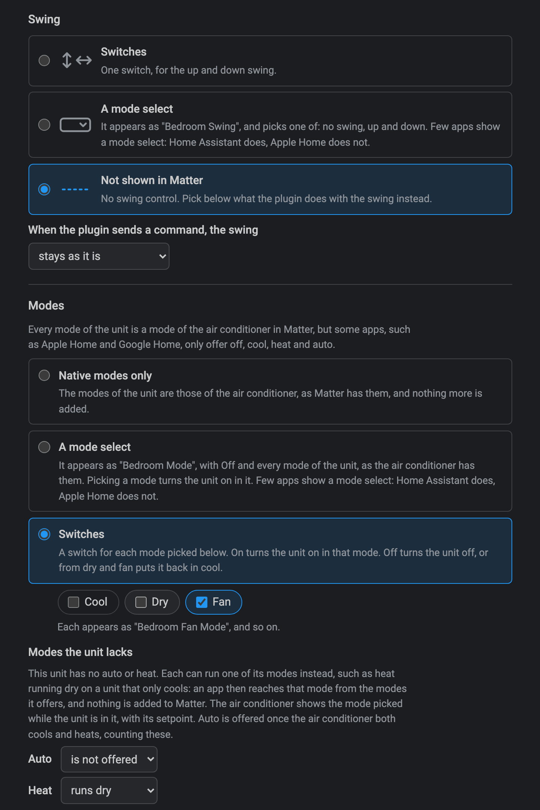
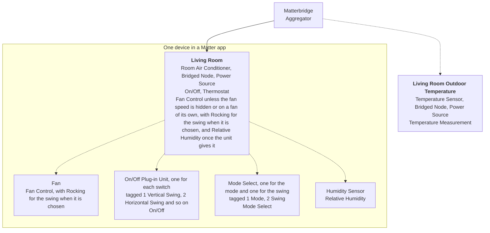
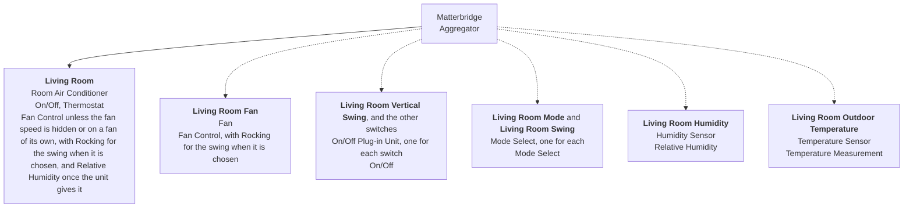

# Matterbridge Daikin Local

[](https://www.npmjs.com/package/matterbridge-daikin-local)
[](https://www.npmjs.com/package/matterbridge-daikin-local)
[](https://github.com/cheziyi/matterbridge-daikin-local/actions/workflows/build.yml)
[](https://github.com/cheziyi/matterbridge-daikin-local/actions/workflows/codeql.yml)
[](https://codecov.io/gh/cheziyi/matterbridge-daikin-local)
[](./LICENSE)

[](https://www.npmjs.com/package/matterbridge)
[](https://www.npmjs.com/package/daikin-local-control)

Control your Daikin air conditioners from Apple Home, Google Home, Alexa, Home Assistant and other Matter apps, **entirely over your local network**. No cloud, no Daikin account, and nothing that stops working when your internet does.

It is a [Matterbridge](https://matterbridge.io) plugin built on [daikin-local-control](https://www.npmjs.com/package/daikin-local-control), for units with a classic (BRP069, BRP072), DSIOT (BRP084) or Airbase (BRP15B61) Wi-Fi adapter: the adapters of the DAIKIN Mobile Controller, Daikin Airbase and ONECTA apps. Not every adapter of each app is covered: see its [coverage and limitations](https://github.com/cheziyi/daikin-local-control#coverage--limitations).

## Why this plugin

- **It finds your air conditioners for you.** Open the setup page and it searches your network, lists every adapter that answers and says what each one will ask for. There are no IP addresses to look up and no configuration file to edit: see [Guided setup](#guided-setup).
- **It works with adapters that ask for their KEY.** Some classic adapters only answer an app they have registered, and some have a child lock code. The setup page asks for each where it is needed, and the plugin does the rest. It is the only Matterbridge plugin that connects to these adapters: see the [comparison](#compared-with-other-daikin-plugins).
- **It keeps working when an adapter gets a new IP address.** The plugin finds the adapter again and updates the address by itself, so an adapter on the same network as Matterbridge needs no fixed address on your router. Each air conditioner has the name you give it in the setup page, which a new name of its adapter does not change. The other local plugins know an adapter by the address you enter and by its name: see [How devices are stored](#how-devices-are-stored).
- **It says when a unit stops answering.** After two reads in a row fail, your Matter app shows the air conditioner as unreachable, and it comes back by itself on the first read that works. A unit that is off when Matterbridge starts is still added, from what the plugin stored. None of the other Daikin plugins reports a unit as unreachable.
- **Almost nothing needs a restart.** Add, rename, reconnect and remove air conditioners while Matterbridge keeps running. A change of how one appears in Matter applies at the next restart, which the setup page and Matterbridge ask for, so that the Matter apps keep it with its room.
- **It is more than a thermostat.** Besides power, mode and temperature you get the fan speed, the swing, the dry and fan modes, and Powerful, Econo and Streamer. The humidity appears by itself on a unit that gives it, and the outdoor temperature on a sensor you turn on.
- **It fits the Matter app you use.** Matter apps differ in what they show, so you choose how each control appears: the fan speed as steps, as a percentage or on a fan of its own, and a switch for each thing your app has no control for. Presets for Apple Home and Google Home give you a starting point: see [Presets](#presets).
- **It offers only what your unit can do.** The plugin asks each unit which modes, fan speeds, swing and temperature limits it has, builds its controls from the answer, and checks again after every start.
- **It is quick.** Each unit is read every 5 seconds unless you set otherwise, so what you change on the remote control shows up in your app within seconds. Several changes an app makes together go to the unit as one command.
- **One plugin for every kind of adapter.** The classic adapters, the newer BRP084 and the Airbase adapter (BRP15B61) of a ducted unit work side by side, set up the same way. No other Matterbridge plugin speaks to all three.

## Requirements

- Matterbridge 3.10.10 or later.
- Node.js 22.19 or later (22, 24 or 26). Node.js 20 is not supported, because daikin-local-control needs 22.19.
- Matterbridge on the same network segment as the adapters, for discovery to find them. Adapters on another subnet or VLAN can be added by address.

## Installation

In the Matterbridge frontend, type `matterbridge-daikin-local` in the **Install plugins** field and click **Install**, then restart Matterbridge.

From the command line instead:

```bash
npm install -g matterbridge-daikin-local
matterbridge --add matterbridge-daikin-local
```

Then set up your air conditioners in the plugin's own page: see [Guided setup](#guided-setup).

## Guided setup

Open the plugin frontend from the plugin's row on the Matterbridge home page. It walks through three steps:

1. **Find.** The plugin searches the network and lists the adapters that answer. If one is missing, add it by its address.
2. **Connect.** For each adapter you picked, the plugin checks what it needs and asks only for that:
   - the **KEY** printed on the adapter's label, for an adapter that only answers registered apps. It is used once to register the Terminal ID and is not stored;
   - the **child lock code**, the 4-digit code set under Child lock in the Daikin app the adapter was set up with, for an adapter that has one.
3. **Options.** The name the air conditioner gets in Matter, starting from the name of its adapter, and how the fan speed, the swing and the extra switches appear in Matter, from what the unit can do. Start from a [preset](#presets) or choose each one yourself.

Afterwards the same page lists your air conditioners with their status. From there you can add more, change the options of one, reconnect one that stopped answering, or remove one. Adding, renaming, reconnecting and removing need no Matterbridge restart; a change of how one appears in Matter takes effect at the next restart, which the page and Matterbridge ask for. Matterbridge's own list of devices shows an air conditioner added or removed here once you reload its page, named after the MAC address of its adapter, such as `Daikin A4:08:EA:CC:91:D4`: the name you give it is what the Matter apps show.

<table>
  <tr>
    <td width="50%" valign="top">
      
      <br><b>Find.</b> The adapters that answered the search, with what each will ask for.
    </td>
    <td width="50%" valign="top">
      
      <br><b>Connect.</b> An adapter that only answers registered apps asks for its KEY, once.
    </td>
  </tr>
  <tr>
    <td valign="top">
      
      <br><b>Connect.</b> An adapter with a child lock asks for its code.
    </td>
    <td valign="top">
      
      <br><b>Afterwards.</b> Your air conditioners, their status and how each appears in Matter.
    </td>
  </tr>
  <tr>
    <td valign="top">
      
      <br><b>Options.</b> Start from a preset, then choose how the fan speed appears.
    </td>
    <td valign="top">
      
      <br><b>Options.</b> The swing, a switch for any mode, and a mode the unit lacks running another.
    </td>
  </tr>
</table>

The screenshots show the setup page with simulated adapters, which is why every address is `127.0.0.1` with a port: see [Development](#development).

The plugin presents itself to every adapter with a **Terminal ID**, which it generates the first time it starts. To reuse an ID that your adapters already have registered, enter it in the plugin's settings in Matterbridge before you set up the adapters: see [Configuration](#configuration).

## How an air conditioner appears in Matter

| In Matter           | From the unit                                                                                                                                                                                                                                             |
| ------------------- | --------------------------------------------------------------------------------------------------------------------------------------------------------------------------------------------------------------------------------------------------------- |
| On/off              | Power                                                                                                                                                                                                                                                     |
| Thermostat mode     | Off, Cool, Heat, Auto, Dry (dehumidify) and Fan only, for the modes the unit has. Not every Matter app offers Dry and Fan only                                                                                                                            |
| Target temperature  | The setpoint of the current mode, within the limits and the step the unit reports. In Auto the unit has one setpoint, which both the heating and the cooling setpoint show. Dry and fan take none: a setpoint changed in them goes back to what it showed |
| Current temperature | The indoor temperature the unit measures                                                                                                                                                                                                                  |
| Humidity            | The indoor humidity, on the air conditioner and, when you add one, on a sensor of its own, for a unit that gives it: see below                                                                                                                            |
| Outdoor temperature | A temperature sensor named `<name> Outdoor Temperature`, when you turn it on, for a unit that gives it: see below                                                                                                                                         |
| Fan speed           | Your choice: see below                                                                                                                                                                                                                                    |
| Swing               | Your choice: see below                                                                                                                                                                                                                                    |

The adapter does not report whether the compressor is running, so a unit that is on is shown as cooling or heating according to its mode.

### How it is built in Matter

Matter describes a device as endpoints. Each endpoint has one or more device types, which say what it is, and clusters, which hold its attributes and commands. Each air conditioner is one device: an endpoint for the air conditioner, with every control or sensor that has no place on it as a part of it, on an endpoint of its own. The outdoor temperature sensor is the exception, and is always a device of its own:



A solid line is always there. A dashed one is there when you choose it in the setup, and for a sensor once the unit gives its reading. The air conditioner also has the Bridged Node and Power Source device types, with the Identify, Bridged Device Basic Information and Power Source clusters: the name and the serial number of the device, whether it is reachable, and that it runs on mains power. Its parts have none of these, because in Matter they belong to the device. The outdoor temperature sensor has them all, with a name and a serial number of its own, so that you can put it in another room of your Matter app, such as outside, and it does not report the outdoor temperature for the room of the air conditioner.

| Device type          | ID     | Stands for                                            |
| -------------------- | ------ | ----------------------------------------------------- |
| Aggregator           | 0x000E | Matterbridge, which holds the devices it bridges      |
| Bridged Node         | 0x0013 | Each device: its name, serial number and reachability |
| Power Source         | 0x0011 | Each device: mains powered                            |
| Room Air Conditioner | 0x0072 | The air conditioner                                   |
| Fan                  | 0x002B | A fan of its own                                      |
| On/Off Plug-in Unit  | 0x010A | Each switch                                           |
| Mode Select          | 0x0027 | The mode select of the mode, and that of the swing    |
| Humidity Sensor      | 0x0307 | A humidity sensor of its own                          |
| Temperature Sensor   | 0x0302 | The outdoor temperature                               |

The setup can also make each part a device of its own: see [One device or several](#one-device-or-several). The names below, such as `<name> Fan`, are those of the parts as devices of their own. As parts they have no name in Matter: a switch or a mode select is tagged with what it is, such as `Vertical Swing`, and a Matter app shows each part in its own way.

### Room temperature, humidity and outdoor temperature

The room temperature and the humidity are always on the air conditioner. You choose whether the humidity also gets a sensor of its own, and whether the outdoor temperature gets a sensor, and each appears once the unit gives it.

| Reading             | In Matter                                                                                                                                                                                                                                                                                                                                                                              |
| ------------------- | -------------------------------------------------------------------------------------------------------------------------------------------------------------------------------------------------------------------------------------------------------------------------------------------------------------------------------------------------------------------------------------- |
| Humidity            | On the air conditioner, beside the room temperature. You can add a humidity sensor of its own, named `<name> Humidity`, for Matter apps that show no humidity on an air conditioner. It shows the same humidity, which stays on the air conditioner for the apps that do                                                                                                               |
| Outdoor temperature | None, unless you turn on a temperature sensor named `<name> Outdoor Temperature`. It is a device of its own, never on the air conditioner or a part of it, so that you can put it in another room, such as outside. It is off by default because a Matter app puts a new device in a room of its choosing, which may show the outdoor temperature as its own until you move the sensor |

- **No adapter says which readings its unit has**, so the plugin goes by what the unit reads. The humidity and the outdoor temperature get their place in Matter the first time the unit gives them: at once for a unit that gave them during setup, and otherwise at the next restart of Matterbridge after the reading first comes, which the setup page and Matterbridge ask for. An outdoor temperature with its sensor turned off needs nothing.
- **A reading keeps its place from then on.** Some units give no outdoor temperature while they are idle, and a sensor that came and went would be a device that comes and goes in your Matter apps.
- **A reading the unit does not give right now shows no value**, instead of the last one it gave. This holds for all three, the room temperature included.
- **Apple Home is reported to show a humidity only on a sensor of its own**, and not on an air conditioner: see the [Home Assistant Matter Hub notes](https://riddix.github.io/home-assistant-matter-hub/devices/temperature-humidity-sensor). The Apple Home preset adds that sensor for that reason. It has not been tested with this plugin.

### Fan speed

| Option     | In Matter                                                                                                                    |
| ---------- | ---------------------------------------------------------------------------------------------------------------------------- |
| Steps      | One step for each speed the unit reports, slowest first (Silent, then Level 1 to 5), and Auto when the unit has it           |
| Percentage | A slider from 0 to 100. The plugin rounds it to the nearest speed of the unit and shows the percentage that speed stands for |
| Not shown  | No fan control. The fan speed either stays as it is, or is set to the speed you pick each time the plugin sends a command    |

Matter also has the fan modes Low, Medium and High, which apps show as buttons or reach by voice. Matterbridge sets a fan mode picked to the middle percentage of its third, 17 %, 50 % or 84 %, which the plugin rounds to the nearest speed as it does any percentage. On a unit with Silent and Level 1 to 5, Low is Silent, Medium Level 2 and High Level 4. With auto as the first step, Low is auto. A unit with two speeds has Low and High alone, and one with a single speed High alone.

Every Matter fan control has an off position below its first step: speed 0, 0 %, or the fan mode Off. An air conditioner has no fan-off of its own, so a Matter app turning the fan to off or 0 sets the first step instead: the slowest speed, or auto when auto is the first step. To let the unit pick the speed, choose auto, wherever the setup puts it: see [Auto fan speed](#auto-fan-speed).

The fan speed is a control of the air conditioner itself. For Matter apps that show no fan speed on an air conditioner, or do not show it well, the setup can move it to a fan of its own instead, named `<name> Fan`, as steps or as a percentage. The air conditioner then has no fan speed, so an app does not show two. No preset does this. The fan behaves the same in either place: it shows the speed the unit holds, also while the unit is off, and setting it to 0 sets the first step. A fan of its own is also on and off with the air conditioner, so an app does not show it running while the unit is off, and turning it on or off turns the air conditioner on or off. An app may turn the fan off when it is dragged to 0, such as Apple Home: the air conditioner then turns off and keeps its fan speed.

#### Auto fan speed

On a unit that has an auto fan speed, the setup puts auto in one of these places in Matter:

| Option               | In Matter                                                                                                                                                                                          |
| -------------------- | -------------------------------------------------------------------------------------------------------------------------------------------------------------------------------------------------- |
| Native fan mode only | The Auto fan mode of the fan speed, as Matter has it. Not every app shows it                                                                                                                       |
| A switch             | The Auto fan mode, and a switch named `<name> Auto Fan` beside it. On sets the fan to auto. Off puts it back at the speed it last ran at, or at a middle speed when the plugin never saw it at one |
| The first step       | Below the slowest speed of the unit: step 1, or the bottom of the slider                                                                                                                           |
| The last step        | Above the fastest speed of the unit: the top step, or 100 %                                                                                                                                        |

A switch or a step is for Matter apps that show no Auto fan mode. A step takes the place of the Auto fan mode, because the two cannot show at once: in the Auto fan mode, Matter holds no percent. As a step, auto shares the scale with the speeds of the unit, so a unit with six speeds gets seven steps. Off and 0 set the first step, as above, so with auto first, turning the fan off sets it to auto. While the fan speed is hidden, only the switch is offered, and not even that with a fixed speed, because that speed is sent with every command.

### Swing

| Option         | In Matter                                                                                                                                                                                                                                                  |
| -------------- | ---------------------------------------------------------------------------------------------------------------------------------------------------------------------------------------------------------------------------------------------------------- |
| Native rocking | The rocking of the fan control, as Matter has it: up and down for the vertical swing, left and right for the horizontal one, and both for 3D, on the axes the unit swings on. Not every app shows it, and Apple Home shows it as a single Oscillate on/off |
| Switches       | One on/off switch for each axis the unit swings on, named `<name> Vertical Swing` and `<name> Horizontal Swing`. A unit that swings on one axis gets one switch. They appear as outlets, the on/off device type every Matter app supports                  |
| Mode select    | One mode select named `<name> Swing`, with Off, Vertical, Horizontal and 3D for the swing modes the unit has. Few Matter apps show it: see [Mode selects](#mode-selects)                                                                                   |
| Not shown      | No swing control. The swing either stays as it is, or is set to the mode you pick each time the plugin sends a command                                                                                                                                     |

The switches and the select are for the Matter apps that show no rocking, or do not handle it well: they take its place, so the fan control has no rocking beside them. A unit whose fan speed is not shown has no fan control, and so no rocking: native rocking falls back to the switches. Fixed louver positions are not controlled from Matter.

On a unit that swings on both axes, native rocking and the switches can have one axis alone: up and down, or left and right. For the rocking, this is for the Matter apps that show it as a single on/off, such as the Oscillate switch of Apple Home, which then turns the swing on that axis on and off. For the switches, it is one switch instead of two. The other axis has no control in Matter and stays as it is.

The Apple Home and Google Home presets pick native rocking on one axis: left and right, or up and down on a unit that swings only up and down. A unit whose fan speed cannot be set has no rocking, so they leave its swing out of Matter and as it is.

### Modes

Every mode of the unit is a native Matter mode of the air conditioner, but some Matter apps, such as Apple Home and, by reports, Google Home, only offer Off, Cool, Heat and Auto. For those apps the setup can add one of these, and can also have the modes the unit lacks run others: see [Modes the unit lacks](#modes-the-unit-lacks).

| Option            | In Matter                                                                                                                                             |
| ----------------- | ----------------------------------------------------------------------------------------------------------------------------------------------------- |
| Native modes only | Nothing more: every mode of the unit is among the modes of the air conditioner. The default                                                           |
| A mode select     | A mode select named `<name> Mode`, with every mode of the unit, on a unit with a dry or a fan mode: see [Mode selects](#mode-selects)                 |
| Switches          | A switch for each mode of the unit you pick, named `<name> Auto Mode`, `<name> Cool Mode`, `<name> Heat Mode`, `<name> Dry Mode` or `<name> Fan Mode` |

A switch does this:

| Switch     | Does                                                                                                                                              |
| ---------- | ------------------------------------------------------------------------------------------------------------------------------------------------- |
| Turned on  | Turns the unit on in that mode                                                                                                                    |
| Turned off | For Dry and Fan, puts the unit back in Cool, or in Heat on a unit that only heats: the unit stays on. For Auto, Cool and Heat, turns the unit off |

A switch is on while the unit is on and in its mode, whichever way it got there.

#### Modes the unit lacks

Each Matter mode the unit lacks can run one of its modes instead, as you pick, such as Heat running dry on a unit that only cools. Picking Heat then turns the unit on in dry, and the air conditioner shows Heat while the unit is in dry, whichever way it got there. Nothing is added to Matter, so an app that offers only Off, Cool, Heat and Auto reaches dry, and it goes with any of the options above: with a switch for Fan, a cool-only unit has every mode in such an app.

- Only a mode the unit lacks can run another, so the unit loses none of its own modes. Any mode of the unit can be run: Heat for dry on a unit that only cools, Auto for fan, or Heat for auto on a unit without a heat mode.
- A replacement can give the air conditioner what the unit lacks: Heat for dry on a unit that only cools makes the air conditioner both heat and cool in Matter.
- Auto can run a mode only once the air conditioner both cools and heats, counting the replacements, because Matter has Auto only with both.
- **Do not use Auto for Apple Home.** Apple Home has an Auto of its own, which never picks Matter's Auto: it picks Cool or Heat itself, from the room temperature, so a mode shown as Auto cannot be reached from Apple Home. Use Cool or Heat there instead. Other apps, such as Home Assistant, pick Matter's Auto.
- No two Matter modes run the same mode of the unit.
- The setpoint and its limits are those of the mode the air conditioner shows: Heat for auto shows the setpoint of auto as the heating setpoint. Dry and fan take no setpoint on any adapter, so in Heat for dry a change of the heating setpoint is not sent, and the setpoint goes back to what it showed.

### Mode selects

A mode select is the Matter device type that picks one value from a list, as a drop-down does. The setup can add one for the mode, named `<name> Mode`, on a unit with a dry or a fan mode, and one for the swing, named `<name> Swing`, as a choice under [Swing](#swing). Each lists only what the unit has, and is chosen instead of the switches: the mode select under [Modes](#modes), and the swing select under [Swing](#swing), instead of the rocking of the fan control as well. No preset adds either.

| Mode select | Lists                                                                    | Picking a value                                                                                                                              |
| ----------- | ------------------------------------------------------------------------ | -------------------------------------------------------------------------------------------------------------------------------------------- |
| Mode        | Off, Auto, Cool, Heat, Dry and Fan Only, as the thermostat mode has them | Off turns the unit off, and any other mode turns it on in that mode. The select shows Off while the unit is off, as the thermostat mode does |
| Swing       | Off, Vertical, Horizontal and 3D                                         | Sets the swing                                                                                                                               |

**Few Matter apps show a mode select.** Home Assistant shows each one as a select among the settings of the device. Apple Home is reported not to show them, and Google Home, Amazon Alexa and SmartThings do not list them among the devices they support. This has not been tested with this plugin. In the other apps, the switches are the way to reach these controls.

The thermostat mode of the air conditioner follows the unit, whichever control changed it: picking Dry or Fan Only on the mode select shows Dry or Fan Only there, and Auto on a unit that only cools or only heats shows Cool or Heat, because Matter has Auto only with both. How an app without Dry or Fan Only, such as Apple Home, shows the air conditioner in those modes is up to the app, as it is with the switches.

### Special modes

Matter has no control for Powerful, Econo and Streamer, so the setup can add a switch for each one the unit reports, named `<name> Powerful`, `<name> Econo` and `<name> Streamer`. None is added unless you ask for it.

- A switch is on while the unit reports that special mode as on, including when the unit turned it on or off by itself.
- Turning a switch on is ignored, and logged, while the unit is in a mode it does not offer that special mode in.

### Presets

In the Options step, a preset fills in every choice above for what the unit can do. You can change any of them afterwards. A new air conditioner starts with the Apple Home preset, and one already set up keeps its own choices.

| Preset              | Fan speed  | Swing               | Modes                | Auto fan | Special mode switches | Humidity                    | Outdoor sensor | Parts of the air conditioner |
| ------------------- | ---------- | ------------------- | -------------------- | -------- | --------------------- | --------------------------- | -------------- | ---------------------------- |
| Apple Home          | Percentage | Rocking on one axis | Dry and fan switches | Switch   | None                  | Also on a sensor of its own | No             | No                           |
| Google Home         | Steps      | Rocking on one axis | Dry and fan switches | Switch   | None                  | Also on a sensor of its own | No             | No                           |
| Full Matter support | Steps      | Native rocking      | Native modes only    | Native   | All                   | On the air conditioner      | Yes            | Yes                          |

### One device or several

The switches, the mode selects, a fan of its own and a humidity sensor of its own are parts of the air conditioner, which Matter calls a composed device, so they move between rooms with it. The outdoor temperature sensor is a device of its own either way, so that you can put it in another room than the air conditioner. The setup can make each of them a device of its own instead, beside the air conditioner. A Matter app then does not know that they belong together, so each is put in a room by itself: moving the air conditioner to another room leaves them where they were. A new device starts with the Apple Home preset, which makes each part a device of its own. The Google Home preset does too, and the Full Matter support preset makes it one composed device: see [Presets](#presets).



|                 | Parts of the air conditioner                                                                                                              | Devices of their own                                               |
| --------------- | ----------------------------------------------------------------------------------------------------------------------------------------- | ------------------------------------------------------------------ |
| In a Matter app | One device                                                                                                                                | One device for the air conditioner, and one for each of the others |
| Rooms           | The parts move with the air conditioner                                                                                                   | Each is put in a room by itself                                    |
| Names           | The air conditioner alone has one. Each switch and each mode select is tagged with a number and with what it is, such as `Vertical Swing` | Each has its own, such as `<name> Vertical Swing`                  |
| Unreachable     | The air conditioner says so for all of them                                                                                               | Each says so itself                                                |

Matter names a device, not its parts, so what a part is called is up to the Matter app. One that reads the tags can show `Vertical Swing`, one that does not shows numbered outlets to rename yourself, and one that shows no parts at all shows the air conditioner alone. This has not been tested in each Matter app: try it in yours, and turn it off if the parts do not show as you want.

Changing the choice applies at the next restart of Matterbridge. The air conditioner keeps its room, but the switches, the mode selects, the fan and the humidity sensor are removed and added in their new place, so a Matter app takes them for new devices: they lose the rooms, the names and the automations they had there.

## Compared with other Daikin plugins

Three other Matterbridge plugins expose Daikin units. Which one fits depends first on how your unit is reached: this plugin and two of the others talk to the adapter over the local network, and the fourth goes through the Daikin Onecta cloud.

This plugin is the only one of the four that finds the adapters itself, that speaks to classic, DSIOT (BRP084) and Airbase (BRP15B61) adapters, and that connects to an adapter which wants its KEY or a child lock code. It is also the only local one that follows an adapter to a new address, and the only one of the four that reports a unit which stops answering as unreachable. The others have strengths of their own: matterbridge-daikin-device controls the humidity, the ventilation and an air purifier, and matterbridge-daikin-onecta is the one for a unit that only the Onecta cloud reaches.

|                              | matterbridge-daikin-local (this plugin)                                                                                                                                                                                  | [matterbridge-daikin-ac](https://github.com/andrasg/matterbridge-daikin-ac)                                                                                     | [matterbridge-daikin-device](https://github.com/lltcggie/matterbridge-daikin-device)                                                                                     | [matterbridge-daikin-onecta](https://github.com/mehmetc/matterbridge-daikin-onecta)            |
| ---------------------------- | ------------------------------------------------------------------------------------------------------------------------------------------------------------------------------------------------------------------------ | --------------------------------------------------------------------------------------------------------------------------------------------------------------- | ------------------------------------------------------------------------------------------------------------------------------------------------------------------------ | ---------------------------------------------------------------------------------------------- |
| Connection                   | Local network, no cloud                                                                                                                                                                                                  | Local network, no cloud                                                                                                                                         | Local network, no cloud                                                                                                                                                  | Daikin Onecta cloud: needs internet, a Daikin Developer Portal app and a sign-in in a browser  |
| Units                        | Those with a classic (BRP069, BRP072), DSIOT (BRP084) or Airbase (BRP15B61) adapter, from the DAIKIN Mobile Controller, Daikin Airbase and ONECTA apps                                                                   | Those with a classic adapter that answers over plain HTTP, which [daikin-controller](https://github.com/Apollon77/daikin-controller) talks to. Not Onecta units | Those with a DSIOT adapter that is a room air conditioner or an air purifier: it turns down any other. Tested on the AN22ZRS air conditioner and the ACK70Z air purifier | Units in the Onecta app: air conditioners and heat pumps                                       |
| Built on                     | [daikin-local-control](https://github.com/cheziyi/daikin-local-control), a library by the same author that works on its own                                                                                              | [daikin-controller](https://github.com/Apollon77/daikin-controller)                                                                                             | Its own DSIOT code                                                                                                                                                       | [daikin-controller-cloud](https://github.com/Apollon77/daikin-controller-cloud)                |
| Adding a unit                | A search of the network and a guided setup page, or by address. No restart                                                                                                                                               | IP addresses in the plugin settings, then a restart                                                                                                             | IP addresses in the plugin settings, then a restart                                                                                                                      | Every unit of the account, with a white list and a black list                                  |
| KEY and child lock code      | Asked for in the setup page, by the adapters that need them                                                                                                                                                              | Not supported: it cannot connect to an adapter that wants its KEY or a child lock code                                                                          | Not supported: it cannot connect to an adapter with a child lock code. DSIOT adapters have no KEY                                                                        | Neither applies: it signs in to the Daikin cloud                                               |
| New address or name          | Found again by the MAC address of its adapter, so no fixed address is needed. Its name is the one you give it, which a new name of the adapter does not change, and which the Matter apps take without losing the device | The address is changed in the settings. A new name makes a new device in Matter, which is known by its name                                                     | The address is changed in the settings, then a restart. A new name makes a new device in Matter, which is known by its name                                              | Neither applies: each unit is known by its cloud ID                                            |
| A unit that stops answering  | Shown as unreachable after two failed reads. One that is off at the start is still added, from what was stored                                                                                                           | Not shown. One that does not answer within 90 seconds of the start is left out until the next restart                                                           | Not shown. One that does not answer at the start is left out until the next restart                                                                                      | Not shown, even while the cloud reports the unit offline                                       |
| Thermostat modes             | Off, Cool, Heat, Auto, Dry and Fan only, and an optional switch for each mode, a mode select, or the modes the unit lacks running others                                                                                 | Off, Cool, Heat, Auto, Dry and Fan only                                                                                                                         | Off, Cool, Heat, Auto, Dry and Fan only, and a mode select that also has humidify                                                                                        | Off, Cool, Heat, Auto, Dry and Fan only                                                        |
| Controls                     | Built from the modes, fan speeds, swing and temperature limits each unit reports                                                                                                                                         | The same for every unit, with fixed temperature limits                                                                                                          | Built for its two tested models                                                                                                                                          | Modes and temperature limits from the cloud                                                    |
| Fan speed                    | Steps, a percentage or not shown, on the air conditioner or on a fan of its own, and an optional switch for the auto speed                                                                                               | No                                                                                                                                                              | Low, Medium, High and Auto, a percentage, or a mode select                                                                                                               | A fan device                                                                                   |
| Swing                        | The rocking of the fan control, a switch for each axis, a mode select, or not shown with the mode you fix                                                                                                                | No                                                                                                                                                              | The airflow direction of each axis, through a mode select                                                                                                                | No                                                                                             |
| Powerful, Econo and Streamer | An optional switch for each                                                                                                                                                                                              | No                                                                                                                                                              | No                                                                                                                                                                       | A switch for Powerful                                                                          |
| Humidity                     | On the air conditioner, and on a sensor of its own if you add one, when the unit gives it                                                                                                                                | No                                                                                                                                                              | Target humidity and ventilation as fans, and a humidity sensor                                                                                                           | A humidity sensor, on units that report it                                                     |
| Outdoor temperature          | A sensor you turn on, when the unit gives it                                                                                                                                                                             | No                                                                                                                                                              | On the air conditioner and on a sensor                                                                                                                                   | A sensor you can turn off                                                                      |
| Other devices                | None                                                                                                                                                                                                                     | None                                                                                                                                                            | The ACK70Z air purifier, with its humidifier, its water tank and its air quality sensors. An optional switch that raises or lowers the setpoint by 0.5 °C                | None                                                                                           |
| How often a unit is read     | Every 5 seconds, or what you set from 2 to 3600                                                                                                                                                                          | Every 3 seconds, or what you set from 2                                                                                                                         | Every 6 seconds. No setting                                                                                                                                              | Every 10 minutes by day and 30 by night, or what you set from 5. Daikin allows 200 calls a day |
| Node.js                      | 22.19 or later, 24 and 26                                                                                                                                                                                                | 24 and 26                                                                                                                                                       | 20, 22 and 24                                                                                                                                                            | 20.19 or later, 22.13 or later, 24 and 26                                                      |
| Documentation                | English                                                                                                                                                                                                                  | English                                                                                                                                                         | Japanese                                                                                                                                                                 | English                                                                                        |
| License                      | Apache-2.0                                                                                                                                                                                                               | MIT                                                                                                                                                             | Apache-2.0                                                                                                                                                               | Apache-2.0                                                                                     |

The table is read from the README, the settings and the source of matterbridge-daikin-ac 2.0.0 and the daikin-controller library it uses, matterbridge-daikin-device 1.0.2 and matterbridge-daikin-onecta 0.1.1, in October 2026. None of the three was run for it.

## How devices are stored

The plugin knows each air conditioner by the **MAC address of its adapter**, so neither a new IP address nor a new name makes it lose track of one. The MAC address is also the serial number the air conditioner has in Matter. A switch, a mode select, a fan or a sensor that is a device of its own has that serial number with a dash and a letter after it, such as `A4:08:EA:CC:91:D4-V` for the vertical swing switch:

- **The address is kept up to date.** The plugin searches the network when it starts, every 5 minutes, and at once when a device stops answering. An adapter that answers from a new address has it updated.
- **Each device has the name you give it in the setup page**, which starts as the name its adapter announces, followed by a number when another device has that name already, such as `Bedroom 2`. A new name of the adapter does not change it. No two devices share a name, because the name is what the Matter apps show and what its switches and sensors are named after.
- **A new name changes nothing else in Matter.** The device keeps its identity: in Matterbridge's own list of devices it is named after the MAC address, such as `Daikin A4:08:EA:CC:91:D4`, and the name you give it is the label the Matter apps show, which a new name replaces in place. The apps keep its room and its automations, and one that let you rename it there keeps the name you chose.
- **An adapter added by address is followed like any other** when a search can reach it: the plugin reads its MAC address at the address you enter. An adapter on another subnet or VLAN, which no search reaches, keeps the address you entered, so give it a fixed one on your router.
- **An adapter that has no name** is named by you in the setup page.
- **An adapter that reports no MAC address cannot be added**, because the plugin would have nothing to follow it by.

What each unit can do is read when it is added, and checked again after each start of the plugin and each time you open its options in the setup page. If it changed, for example after an update of the unit's firmware or of this plugin, a setting the unit no longer takes is reset, and the air conditioner is built again in Matter at the next restart of Matterbridge, which the setup page and Matterbridge ask for.

The devices are stored in the plugin configuration, which Matterbridge keeps in `matterbridge-daikin-local.config.json`, with the child lock code as plain text. They are added, changed and removed in the setup page only: the Matterbridge config editor does not list them.

A stored device that this version of the plugin cannot read, for example one stored by a later version, is ignored and logged. It stays in the configuration as it is, until a device with its name or its MAC address is added in the setup page. A setting whose stored value is not valid falls back to its default, which is logged as well.

## Configuration

| Setting                          | Meaning                                                                                                                                                                                                                                                                                                                                                          |
| -------------------------------- | ---------------------------------------------------------------------------------------------------------------------------------------------------------------------------------------------------------------------------------------------------------------------------------------------------------------------------------------------------------------- |
| `terminalUuid`                   | The Terminal ID: 32 lowercase hexadecimal digits, a UUID without its dashes, such as `0d120767302b4603b5ae916260815e4e`. The settings refuse any other form. Generated when empty. An adapter that asks for its KEY only answers an ID it has registered, so changing this means registering those adapters again                                                |
| `pollIntervalInSeconds`          | How often the state of each unit is read, 2 to 3600. Defaults to 5. A change made on the unit's own remote shows up in Matter after at most this long                                                                                                                                                                                                            |
| `maxStateAgeForCommandInSeconds` | How old the state read by the last poll may be for a command to be built from it, 0 to 3600. Defaults to 30, and the poll interval is used instead when it is shorter. Past this age, and always at 0, the unit is read again first, which makes the command slower. A higher value undoes more of what was changed on the unit's own remote since the last poll |

## Good to know

- **Commands are grouped.** A Matter app often changes several things at once. The plugin collects the changes of 300 milliseconds and sends them to the unit as one command.
- **Requests to one adapter go one at a time.** The reads and the commands of a device wait for each other, and different devices are read at the same time. A check from the setup page uses a connection of its own, so it can overlap with a read.
- **A command is built from the last poll** instead of reading the unit again first, when that poll is no older than the poll interval, or than 30 seconds when the interval is longer. In that window, a change made on the unit's own remote control since the last poll is undone by the command. Set a shorter poll interval to narrow it.
- **A device is reported as unreachable** after two reads in a row fail, and as reachable again on the first read that works.
- **What the Matter apps keep follows one rule: whatever stays keeps its room and its automations, and whatever was removed comes back as new.** A restart, a new name, a new address and a change of options keep the air conditioner and every switch or sensor that stays. A switch or a sensor that an option change adds is new, in the default room. One that is removed is gone, and turned on again later it is new as well, never the one the apps knew. A removed air conditioner added again is new too, with all its switches and sensors.
- **Changing how the fan, the swing, any switch or any sensor appears** takes effect at the next restart of Matterbridge, which the setup page and Matterbridge ask for. Until then the air conditioner keeps its current controls.
- **The settings and the setup page do not overlap.** The Terminal ID and the poll interval are set in the plugin's settings in Matterbridge, and the air conditioners in the setup page. A save of the settings never changes the air conditioners.
- **The setup page is as open as Matterbridge itself.** Anyone who can reach the Matterbridge frontend can use it. It never returns a stored child lock code.
- **A ducted unit on an Airbase adapter** gets the controls of any other unit: power, mode, target temperature, fan speed and swing. Its zones, its fan auto and its airside are not in Matter. A unit with zones reports no auto fan speed and no swing, so it gets neither, and an Airbase adapter asks for no KEY and no child lock code.
- **Local HTTPS.** Adapters that speak HTTPS present a certificate from Daikin's own CA, which is not verified: see [Local HTTPS](https://github.com/cheziyi/daikin-local-control#local-https).

## Development

The plugin is developed from the [Matterbridge plugin template](https://github.com/Luligu/matterbridge-plugin-template); see its README for the dev container and the toolchain, and [STYLEGUIDE.md](./STYLEGUIDE.md) and [AGENTS.md](./AGENTS.md) for the conventions.

```bash
npm install
npm link matterbridge        # with matterbridge installed globally
npm run build                # the plugin, into dist
npm run build:frontend       # the setup page, into apps/frontend/build (run npm install in apps/frontend and npm run build first)
npm run test:coverage
npm run lint
```

The plugin's source is in [src](./src), and its tests follow the same layout under [vitest](./vitest):

| Path                             | What it holds                                                                                                           |
| -------------------------------- | ----------------------------------------------------------------------------------------------------------------------- |
| [module.ts](./src/module.ts)     | The platform: the Matterbridge entry point, the stored device list and the devices that run from it.                    |
| [config.ts](./src/config.ts)     | The stored configuration: its model, its validation and its comparisons.                                                |
| [controls.ts](./src/controls.ts) | What the capabilities of a unit let its device have in Matter.                                                          |
| [mapping.ts](./src/mapping.ts)   | The conversions between the Daikin model and the Matter clusters.                                                       |
| [errors.ts](./src/errors.ts)     | The helpers that describe errors.                                                                                       |
| [accessory/](./src/accessory)    | One air conditioner in Matter: its endpoints, what the controllers ask of it and what its unit answers.                 |
| [platform/](./src/platform)      | What the platform keeps between restarts and searches: the capabilities of each unit, its own saves, the new addresses. |
| [setup/](./src/setup)            | The guided setup: the checks of an adapter and the REST API of the setup page.                                          |

The setup page is a small TypeScript page without a framework, in [apps/frontend](./apps/frontend), which esbuild bundles into one `app.js`. Matterbridge serves `apps/frontend/build` at `/plugins/matterbridge-daikin-local/`, and the page calls the plugin through `onFetch`: see [src/setup/setupApi.ts](./src/setup/setupApi.ts). The page takes the types of what the plugin sends from the plugin itself, through a TypeScript project reference to the plugin's build, which is why the plugin is built first. What a unit leaves to choose is worked out by the plugin and sent to the page: see `getAvailableControls` in [src/controls.ts](./src/controls.ts).

To run the plugin without an air conditioner, start simulated adapters with the [simulators of daikin-local-control](https://github.com/cheziyi/daikin-local-control#simulators). One started with `answersDiscovery: true` is found by the setup page, at `127.0.0.1` and a port of its own. The [screenshots](./screenshots) of the guided setup were taken this way.

## Legal disclaimer

An independent, community project for local interoperability and home automation. It is not affiliated with, authorized, or endorsed by Daikin Industries, Ltd. All product names and trademarks are the property of their respective owners.

## License

[Apache-2.0](./LICENSE)
